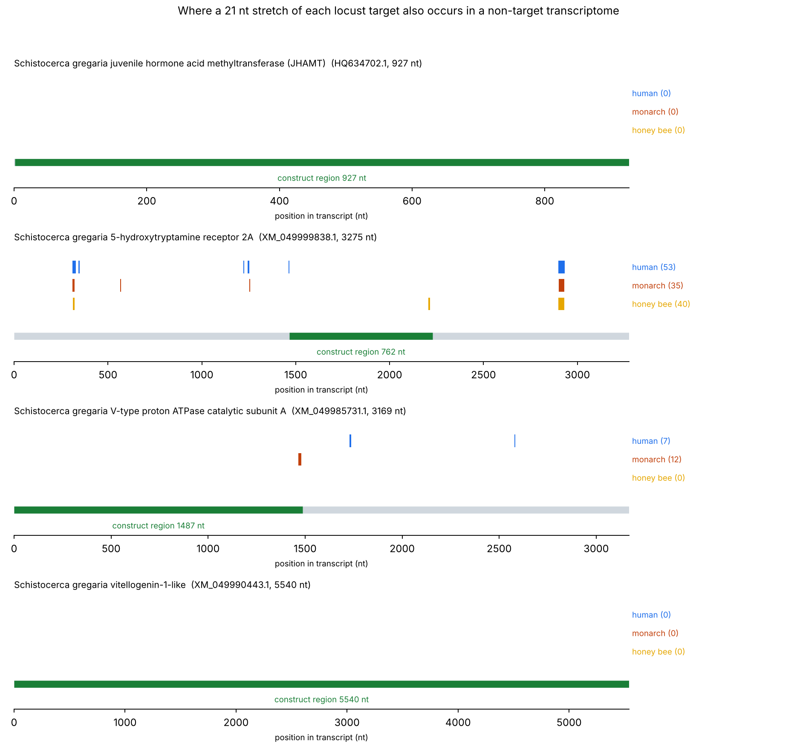

# Off-target screen for RNAi-based locust control

A conceptual poster I presented in 2025 proposed silencing desert locust
(*Schistocerca gregaria*) genes with RNA interference, and claimed the approach
would spare pollinators. I had no way to test that claim at the bench, so I
tested the part that can be tested on a laptop: whether the RNA sequences
themselves are specific to the locust.

## The question

RNA interference acts through short exact matches. If a stretch of the dsRNA
you spray also occurs in a bee's transcriptome, that bee's cells can act on it.
A 2017 screen of 74 published pesticidal dsRNAs found that every one of them
matched the honey bee genome somewhere ([Mogren & Lundgren, *PeerJ*](https://peerj.com/articles/4131)).
That paper asked which designs are risky. I wanted the constructive version:
**which regions of my genes are safe to build from.**

## Method

For each target transcript I take every k-nucleotide window, on both strands,
and ask whether it occurs anywhere in a non-target transcriptome. Matching is
exact and done with an Aho-Corasick automaton, so all three non-target
transcriptomes (880 Mnt in total) are streamed once.

- **k = 21** is the usual regulatory criterion, a shared 21 nt exact match.
- **k = 16** is reported as a stricter tier, and as a control: at 16 nt a
  transcriptome this size is expected to contain matches by chance, and it does.

Targets (NCBI): `XM_049990443` vitellogenin-1-like, `HQ634702` JHAMT,
`XM_049985731` V-type proton ATPase catalytic subunit A, `XM_049999838` 5-HT2A
receptor.
Non-targets (NCBI RefSeq RNA): *Apis mellifera*, *Danaus plexippus*,
*Homo sapiens*.

## Results

| Gene | Role | Length | Flagged at 21 nt | Observed / chance | Longest clean region |
| --- | --- | --- | --- | --- | --- |
| Vitellogenin | reproduction | 5,540 nt | 0 | 0.0 | whole transcript |
| JHAMT | development | 927 nt | 0 | 0.0 | whole transcript |
| V-ATPase subunit A | digestion | 3,169 nt | 19 | 15.0x | 1,487 nt (1–1487) |
| 5-HT2A receptor | swarming behaviour | 3,275 nt | 62 | 47.5x | 762 nt (1467–2228) |



The result splits cleanly along what each gene does:

1. **The insect-specific targets are safe.** Vitellogenin and JHAMT, which act
   in reproduction and development, have no 21 nt window in common with any of
   the three non-target transcriptomes. Vitellogenin is the longest transcript
   of the four and still matches nothing.
2. **The conserved targets are not.** V-ATPase runs the cell's proton pump and
   5-HT2A is a conserved receptor, so both have stretches shared with animals
   that are not locusts. 40 windows of 5-HT2A occur in the honey bee. It was
   the gene the poster leaned on hardest, and it is the one most likely to
   reach a pollinator.
3. **16 nt is noise, 21 nt is signal.** At k = 16 the observed counts fall
   *below* the chance expectation (ratio 0.5–0.6), which is what a threshold
   dominated by random matching looks like. At k = 21 the same genes sit 15 to
   48 times above chance, so those matches are real homology.

Each gene still has a region long enough for a hairpin construct, listed in
`results/candidate_dsRNA_regions.fasta`.

## Limitations

A sequence match is not a phenotype. This screen says where an off-target
effect is *possible*, not that it would occur: uptake, processing and dose all
matter, and none of them are modelled here. It also only covers three species
and only the transcripts in RefSeq. It is a filter to apply before ordering
constructs, not a safety assessment.

## Running it

```
pip install pyahocorasick matplotlib
python src/screen.py      # downloads must already be in data/
python src/analyse.py
```

`data/fetch.sh` retrieves the sequences from NCBI (about 165 MB; not committed).

Full citations and accession numbers: [REFERENCES.md](REFERENCES.md).

Built with AI assistance for the code. The design of the screen, the choice of
thresholds and the interpretation are my own.
